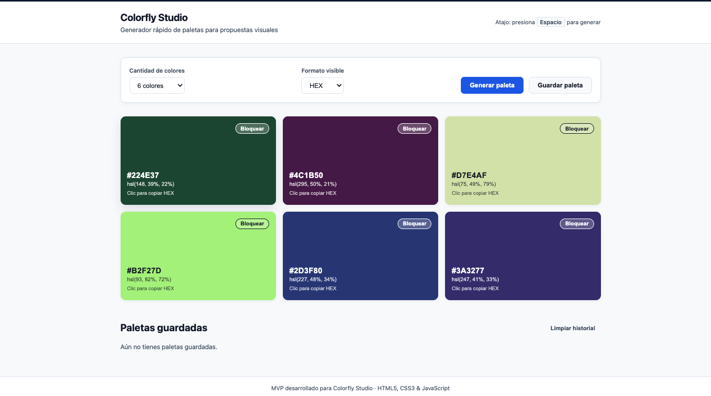
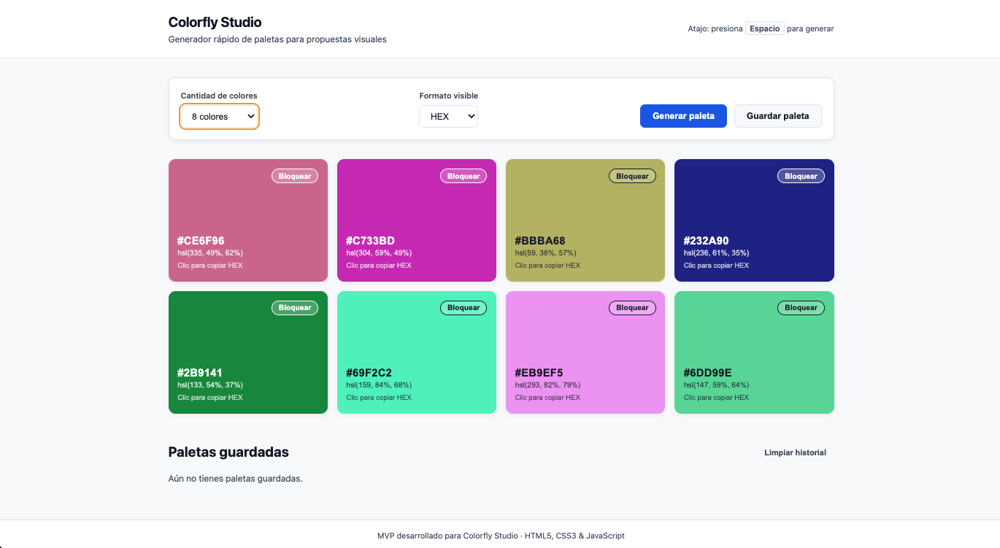
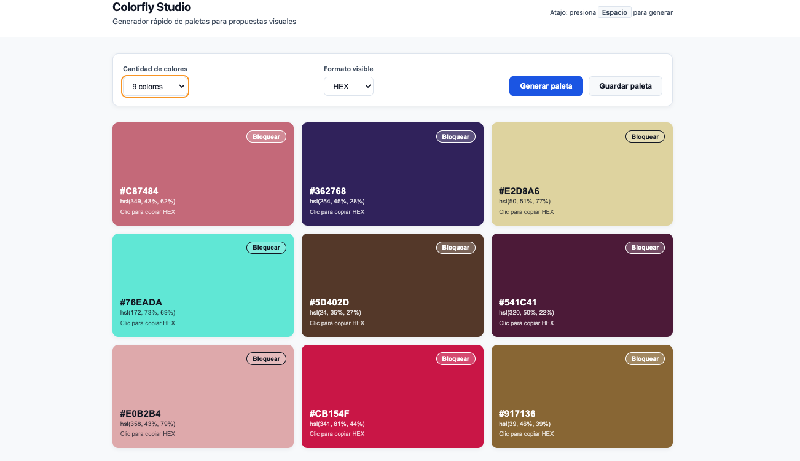
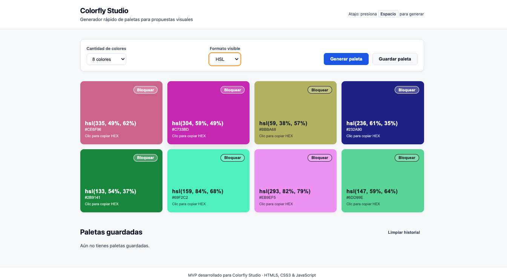
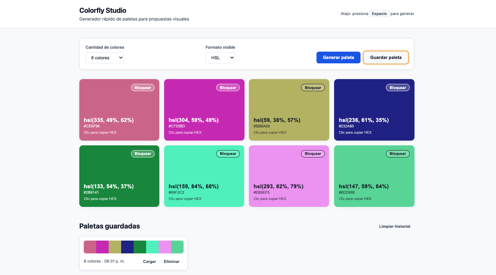

# 🎨 Colorfly Studio — Generador de Paletas de Colores (MVP)


## 📖 Descripción del Proyecto

**Colorfly Studio** es una agencia de branding que desarrolla propuestas visuales para más de 300 clientes en distintas ciudades. Con el objetivo de acelerar el flujo creativo del equipo de diseño y estandarizar las propuestas iniciales, nace esta aplicación web estática e interactiva.

Este repositorio contiene el **Producto Mínimo Viable (MVP)** de una herramienta intuitiva que permite generar paletas de colores aleatorias en segundos, ofreciendo retroalimentación visual inmediata y garantizando una experiencia accesible y fluida en cualquier dispositivo.

---

## ✨ Características Principales

- **Generación rápida de paletas:** Crea combinaciones aleatorias de colores con un solo clic o mediante atajos de teclado (ej. tecla `Espacio`).






- **Feedback visual inmediato:** Al hacer clic en un código de color (HEX), este se copia automáticamente al portapapeles mostrando una notificación visual clara (`¡Copiado!`).
- **Diseño Responsivo (Mobile-First):** Interfaz adaptable a dispositivos móviles, tablets y pantallas de escritorio.
- **Enfoque en Accesibilidad (A11y):**
  - Uso de HTML5 semántico.
  - Navegación completa mediante teclado (`Tab`, `Enter`, `Espacio`).
  - Ajuste dinámico de contraste de texto sobre los colores generados para asegurar legibilidad.
  - Atributos ARIA para lectores de pantalla (ej. `aria-live` para anunciar colores copiados).

---

## 🖼️ Vista Previa

> *(Nota: Reemplaza este bloque con una captura de pantalla o GIF de tu aplicación en funcionamiento y el enlace a tu despliegue).*

```text
[ Aquí puedes insertar una imagen:  ]
```

🔗 **Demo en video:** 
<a href="https://youtu.be/P0KL2XA8BRE" target="_blank" rel="noopener noreferrer">Video demo en youtube</a>

🔗 **Demo en vivo:** <a href="carotobarj.github.io/PaletaColores" target="_blank" rel="noopener noreferrer">App Desplegada</a>

---

## 🛠️ Tecnologías Utilizadas

Este proyecto fue desarrollado utilizando tecnologías web estándar sin dependencias externas pesadas para garantizar máxima velocidad y rendimiento:

- **HTML5:** Estructura semántica y accesible.
- **CSS3:** Estilos modernos con Flexbox/Grid, variables CSS (`Custom Properties`) y transiciones suaves.
- **JavaScript (ES6+):** Lógica de generación aleatoria de colores, manipulación del DOM y uso de la API del portapapeles (`Clipboard API`).
- **Git & GitHub:** Control de versiones siguiendo buenas prácticas de commits semánticos.

---

## 📁 Estructura del Proyecto

```text
colorfly-studio-mvp/
├── index.html          # Estructura principal de la aplicación
├── css/
│   └── styles.css      # Estilos globales, diseño responsivo y variables
├── js/
│   └── app.js          # Lógica de generación de paletas e interactividad
├── assets/             # Imágenes, íconos y capturas para documentación
└── README.md           # Documentación del proyecto
```

---

## 🚀 Instalación y Uso Local

Al ser una aplicación web estática, no requiere instalación de dependencias ni compilación. Solo sigue estos pasos:

1. **Clona el repositorio:**
   ```bash
   git clone https://github.com/tu-usuario/colorfly-studio-mvp.git
   ```
2. **Ingresa al directorio del proyecto:**
   ```bash
   cd colorfly-studio-mvp
   ```
3. **Ejecuta la aplicación:**
   - Abre el archivo `index.html` directamente en tu navegador web preferido, **o**
   - Utiliza una extensión como **Live Server** en VS Code para una mejor experiencia de desarrollo.

---

## 🤝 Buenas Prácticas y Versionado

Durante el desarrollo de este MVP se aplicaron los siguientes estándares:

- **Código Limpio:** Nombres descriptivos para variables, funciones y clases CSS (metodología BEM o similar).
- **Conventional Commits:** Historial de cambios claro y estructurado (`feat:`, `fix:`, `style:`, `docs:`, `refactor:`).
- **Accesibilidad:** Validación de contraste de colores y soporte para lectores de pantalla.

---

## 🗺️ Próximas Mejoras (Roadmap)

- [ ] Permitir bloquear colores individuales mientras se generan el resto de la paleta.
- [ ] Exportar paletas en formatos CSS, SCSS o JSON.
- [ ] Selector de armonías de color (análogos, complementarios, monocromáticos).
- [ ] Guardado de paletas favoritas utilizando `localStorage`.

---

## 👤 Autor

**[Carolina Tobar Jaramillo]** 

- GitHub: [@tu-usuario]([https://github.com/carotobarj])

---
